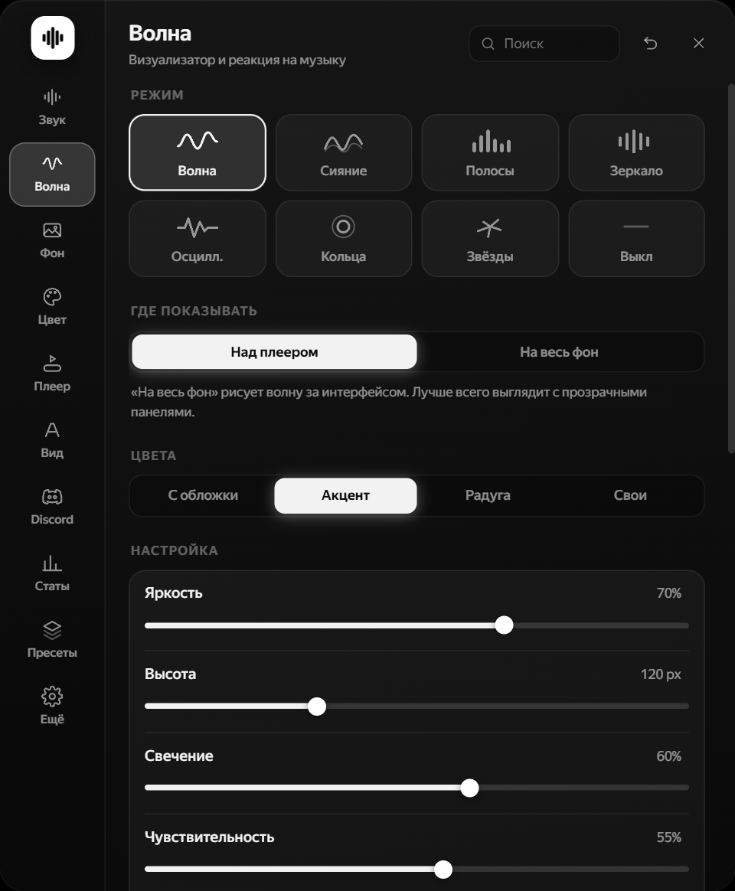
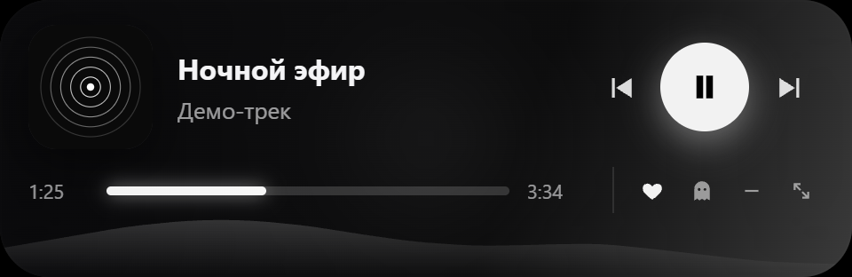
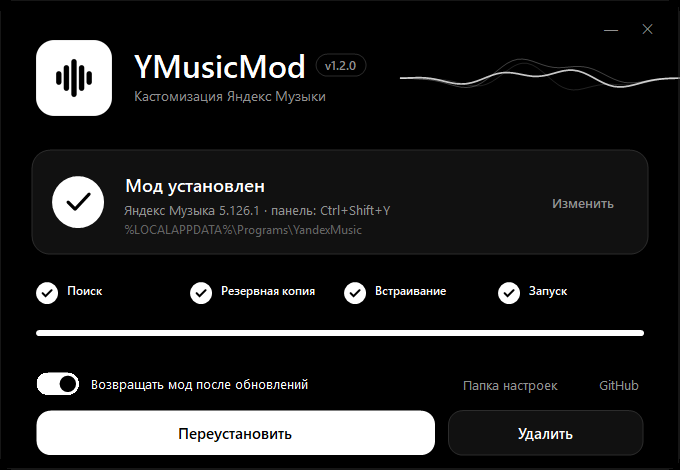

<p align="center">
  <a href="https://attent10nc.github.io/YMusicMod/"></a>
</p>

<p align="center">
  <a href="https://github.com/attent10nc/YMusicMod/releases/latest/download/YMusicMod-Setup.exe">
    
  </a>
</p>

<p align="center">
  <a href="https://attent10nc.github.io/YMusicMod/"><b>Сайт</b></a> &nbsp;&nbsp;
  <a href="https://github.com/attent10nc/YMusicMod/releases">Все версии</a> &nbsp;&nbsp;
  <a href="CHANGELOG.md">Что нового</a>
</p>

<p align="center">Windows 10 и 11. Встаёт на любую версию Яндекс Музыки. Лицензия MIT.</p>

<br>

<table>
  <tr>
    <td width="50%" valign="top">
      
    </td>
    <td width="50%" valign="top">
      <h3>Всё в одной панели</h3>
      <p>Открывается по <kbd>Ctrl</kbd>+<kbd>Shift</kbd>+<kbd>Y</kbd> или через язычок у левого края окна.</p>
      <p><b>Волна.</b> Семь режимов на видеокарте: волна, сияние, полосы, зеркало, осциллограф, кольца, звёзды. Над плеером или на весь фон.</p>
      <p><b>Звук.</b> Студийная обработка с профилями, бас, баланс, своя скорость, slowed, nightcore, 8D, таймер сна.</p>
      <p><b>Фон и вид.</b> Фото, GIF, видео или размытая обложка трека. Любой шрифт, свой логотип, анимации всего интерфейса.</p>
      <p><b>Плеер на весь экран.</b> Фон из обложки, волна вокруг неё, чистый режим с текстом песни.</p>
      <p><b>Discord.</b> Обложка в высоком качестве, фото артиста, год и жанр, ссылки на трек и артиста, свои строки статуса.</p>
      <p><b>Статистика.</b> Время, любимые часы, топ артистов и треков. Хранится только у вас.</p>
      <p><b>Настройки.</b> Поиск, отмена по <kbd>Ctrl</kbd>+<kbd>Z</kbd>, быстрые команды по <kbd>Ctrl</kbd>+<kbd>K</kbd>, автокопии и восстановление.</p>
    </td>
  </tr>
</table>

<p align="center">
  
</p>
<p align="center">Мини-плеер поверх окон. Не забирает фокус у игры и прячется сам, когда запущено что-то полноэкранное.</p>

## Установка

1. Нужна [Яндекс Музыка для Windows](https://music.yandex.ru/download/).
2. Скачайте [`YMusicMod-Setup.exe`](https://github.com/attent10nc/YMusicMod/releases/latest/download/YMusicMod-Setup.exe) и запустите.
3. Установщик сам найдёт приложение, поставит мод и перезапустит Яндекс Музыку.

<p align="center">
  
</p>

Если Яндекс Музыка стоит в нестандартной папке, установщик попросит её указать.
Windows может предупредить, что издатель неизвестен (файл не подписан сертификатом): нажмите «Подробнее», затем «Выполнить в любом случае».

**Обновления.** С включённой опцией «Возвращать мод после обновлений» в автозагрузке висит маленький процесс (около 10 МБ). Яндекс Музыка обновилась, и через несколько секунд мод снова на месте.
Мод встраивается рядом с кодом приложения, поэтому встаёт на разные версии. Внутри приложения он правит только настройки списков и возвращает кнопку «Загрузить трек». Если в новой версии этих мест нет, мод их пропускает.

**Удаление.** Запустите установщик и нажмите «Удалить»: приложение вернётся к исходному виду.
Настройки и фоны остаются в `%APPDATA%\YandexMusic\YMusicMod`.

## Горячие клавиши

| Клавиши | Действие |
|---|---|
| <kbd>Ctrl</kbd>+<kbd>Shift</kbd>+<kbd>Y</kbd> | панель настроек |
| <kbd>Ctrl</kbd>+<kbd>K</kbd> | быстрые команды |
| <kbd>Ctrl</kbd>+<kbd>Z</kbd> | отменить изменение настроек (в панели) |
| <kbd>Ctrl</kbd>+<kbd>Shift</kbd>+<kbd>F</kbd> | плеер на весь экран |
| <kbd>Ctrl</kbd>+<kbd>Shift</kbd>+<kbd>V</kbd> | следующий режим волны |
| <kbd>Ctrl</kbd>+<kbd>Shift</kbd>+<kbd>B</kbd> | пульс под бит |
| <kbd>Ctrl</kbd>+<kbd>Shift</kbd>+<kbd>P</kbd> | следующий пресет |
| <kbd>Ctrl</kbd>+<kbd>Shift</kbd>+<kbd>N</kbd> | следующий фон |
| <kbd>Ctrl</kbd>+<kbd>Shift</kbd>+<kbd>M</kbd> | мини-плеер |
| <kbd>Ctrl</kbd>+<kbd>Shift</kbd>+<kbd>R</kbd> | меньше анимаций |

Работают из любого окна и в играх:

| Клавиши | Действие |
|---|---|
| <kbd>Ctrl</kbd>+<kbd>Alt</kbd>+<kbd>Space</kbd> | пауза и воспроизведение |
| <kbd>Ctrl</kbd>+<kbd>Alt</kbd>+<kbd>→</kbd> и <kbd>←</kbd> | следующий и предыдущий трек |
| <kbd>Ctrl</kbd>+<kbd>Alt</kbd>+<kbd>↑</kbd> и <kbd>↓</kbd> | громкость |
| <kbd>Ctrl</kbd>+<kbd>Alt</kbd>+<kbd>L</kbd> | нравится |
| <kbd>Ctrl</kbd>+<kbd>Alt</kbd>+<kbd>M</kbd> | скрыть или показать мини-плеер |
| <kbd>Ctrl</kbd>+<kbd>Alt</kbd>+<kbd>G</kbd> | мини-плеер «призрак»: полупрозрачный, клики проходят сквозь |

## Вопросы

<details>
<summary><b>Это безопасно для аккаунта?</b></summary>
<br>
Мод меняет только файлы приложения на вашем компьютере и перед этим делает резервную копию.
Логин, пароль и подписку он не трогает и никуда их не отправляет. Данные треков запрашиваются
у того же сервера Яндекса, что и в самом приложении, шрифты скачиваются с Google Fonts, только если
вы их выбрали, а статистика прослушиваний хранится только у вас. Весь код открыт.
</details>

<details>
<summary><b>Не видно статуса в Discord</b></summary>
<br>
Discord, Настройки, Конфиденциальность активности, «Делиться активностью».
Discord должен быть запущен на этом же компьютере.
</details>

<details>
<summary><b>Мини-плеер не реагирует на клики</b></summary>
<br>
Скорее всего включён режим «призрак». Нажмите <kbd>Ctrl</kbd>+<kbd>Alt</kbd>+<kbd>G</kbd>.
</details>

<details>
<summary><b>Мод пропал после обновления</b></summary>
<br>
Запустите установщик ещё раз. Чтобы так не было, оставьте включённой опцию «Возвращать мод после обновлений».
</details>

<details>
<summary><b>Что-то сломалось</b></summary>
<br>
Нажмите «Удалить» в установщике и создайте <a href="https://github.com/attent10nc/YMusicMod/issues">issue</a> с версией Яндекс Музыки. Сведения для отчёта можно скопировать в панели: раздел «Ещё», «Скопировать сведения».
</details>

## Сборка

Windows и Node.js 18+. Компилятор C# уже есть в системе в составе .NET Framework.

```powershell
npm install
npm run build     # dist\YMusicMod-Setup.exe
npm run check     # проверить, встаёт ли мод на установленную версию
npm run patch     # накатить исходники напрямую (Яндекс Музыка должна быть закрыта)
```

```
src/mod/          код, который встраивается в приложение
src/installer/    установщик и фоновый процесс (C#, WinForms)
scripts/          сборка
assets/           логотип и картинки
docs/             сайт проекта
```

Релиз: поднимите `version` в `package.json`, поставьте тег `vX.Y.Z` и запушьте. GitHub Actions соберёт установщик и прикрепит его к релизу.

## Лицензия

[MIT](LICENSE). Проект не связан с ООО «Яндекс»; «Яндекс Музыка» является товарным знаком правообладателя.
