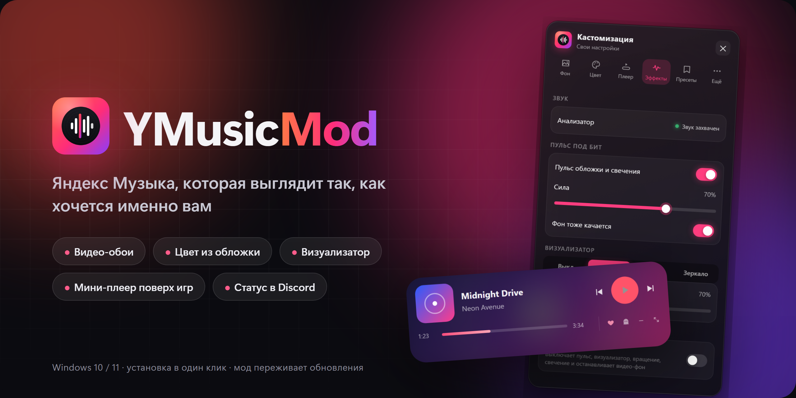
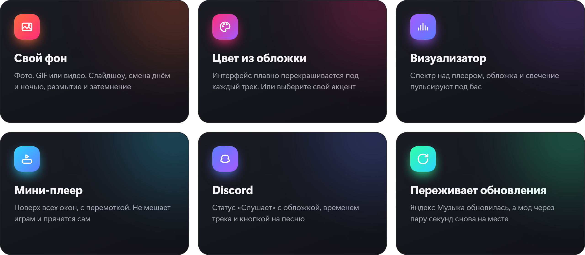
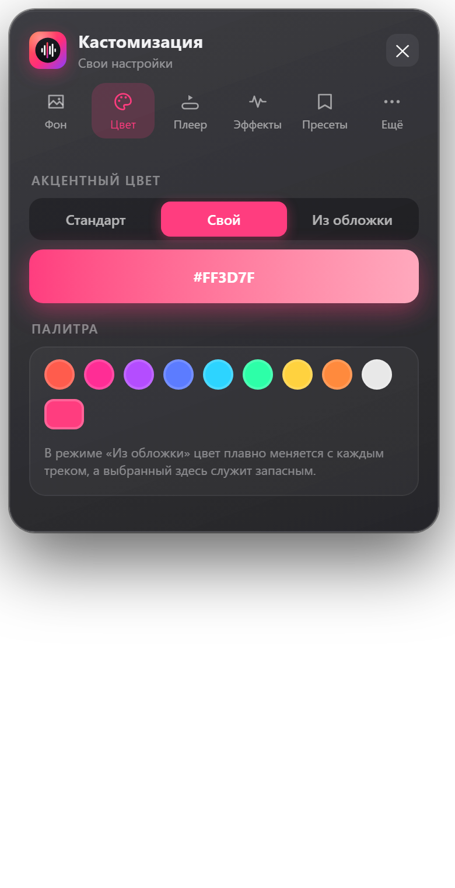
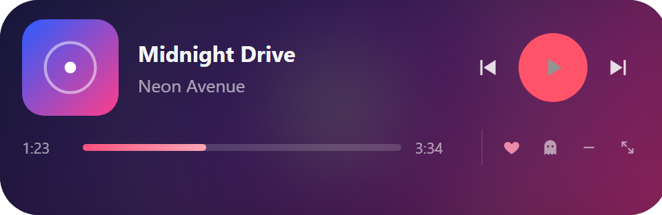
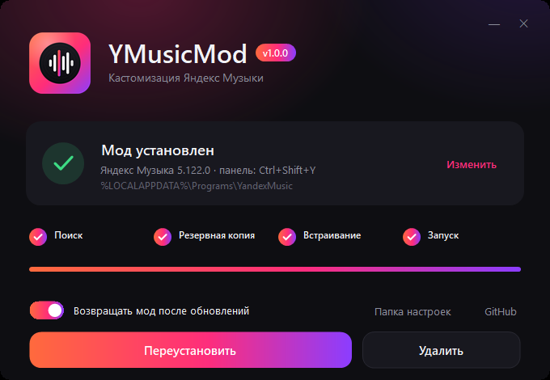

<p align="center">
  
</p>

<p align="center">
  <a href="https://github.com/attent10nc/YMusicMod/releases/latest/download/YMusicMod-Setup.exe">
    
  </a>
</p>

<p align="center">
  
  
  
</p>

<br>

<p align="center">
  
</p>

## Как это выглядит

<table>
  <tr>
    <td width="50%" valign="top">
      
    </td>
    <td width="50%" valign="top">
      <h3>Всё в одной панели</h3>
      <p>Открывается по <kbd>Ctrl</kbd>+<kbd>Shift</kbd>+<kbd>Y</kbd> или через язычок у левого края окна.</p>
      <p><b>Фон</b> — галерея фото, GIF и видео, слайдшоу, день и ночь.<br>
      <b>Цвет</b> — свой акцент или из обложки трека.<br>
      <b>Плеер</b> — стекло, свечение, вид ползунка, громкость колёсиком.<br>
      <b>Эффекты</b> — визуализатор, пульс под бит, «меньше анимаций».<br>
      <b>Пресеты</b> — встроенные и свои, экспорт в JSON.<br>
      <b>Ещё</b> — мини-плеер, Discord, горячие клавиши.</p>
      <br>
      
      <p>Мини-плеер поверх окон. Не забирает фокус у игры и прячется сам, когда запущено что-то полноэкранное.</p>
    </td>
  </tr>
</table>

## Установка

1. Нужна [Яндекс Музыка для Windows](https://music.yandex.ru/download/).
2. Скачайте [`YMusicMod-Setup.exe`](https://github.com/attent10nc/YMusicMod/releases/latest/download/YMusicMod-Setup.exe) и запустите.
3. Всё. Установщик сам найдёт приложение, поставит мод и перезапустит Яндекс Музыку.

<p align="center">
  
</p>

Если Яндекс Музыка стоит в нестандартной папке, установщик попросит её указать.
Windows может предупредить, что издатель неизвестен (файл не подписан сертификатом):
«Подробнее» → «Выполнить в любом случае».

**Обновления.** С включённой опцией «Возвращать мод после обновлений» в автозагрузке висит крошечный
процесс (около 10 МБ). Яндекс Музыка обновилась — через несколько секунд мод снова на месте.
Мод не лезет во внутренний код приложения, поэтому встаёт на разные версии.

**Удаление.** Запустите установщик и нажмите «Удалить» — приложение вернётся к исходному виду.
Настройки и фоны остаются в `%APPDATA%\YandexMusic\YMusicMod`.

## Горячие клавиши

| Клавиши | Действие |
|---|---|
| <kbd>Ctrl</kbd>+<kbd>Shift</kbd>+<kbd>Y</kbd> | панель настроек |
| <kbd>Ctrl</kbd>+<kbd>Shift</kbd>+<kbd>B</kbd> | пульс под бит |
| <kbd>Ctrl</kbd>+<kbd>Shift</kbd>+<kbd>V</kbd> | режим визуализатора |
| <kbd>Ctrl</kbd>+<kbd>Shift</kbd>+<kbd>P</kbd> | следующий пресет |
| <kbd>Ctrl</kbd>+<kbd>Shift</kbd>+<kbd>N</kbd> | следующий фон |
| <kbd>Ctrl</kbd>+<kbd>Shift</kbd>+<kbd>M</kbd> | мини-плеер |
| <kbd>Ctrl</kbd>+<kbd>Shift</kbd>+<kbd>R</kbd> | меньше анимаций |
| <kbd>Ctrl</kbd>+<kbd>Alt</kbd>+<kbd>M</kbd> | скрыть / показать мини-плеер (работает и в играх) |
| <kbd>Ctrl</kbd>+<kbd>Alt</kbd>+<kbd>G</kbd> | мини-плеер «призрак»: полупрозрачный, клики проходят сквозь |

## Вопросы

<details>
<summary><b>Это безопасно для аккаунта?</b></summary>
<br>
Мод меняет только файлы приложения на вашем компьютере и перед этим делает резервную копию.
Логин, пароль и подписку он не трогает и никуда ничего не отправляет. Весь код открыт.
</details>

<details>
<summary><b>Не видно статуса в Discord</b></summary>
<br>
Discord → Настройки → Конфиденциальность активности → «Делиться активностью».
Discord должен быть запущен на этом же компьютере.
</details>

<details>
<summary><b>Мини-плеер не реагирует на клики</b></summary>
<br>
Скорее всего включён режим «призрак» — нажмите <kbd>Ctrl</kbd>+<kbd>Alt</kbd>+<kbd>G</kbd>.
</details>

<details>
<summary><b>Мод пропал после обновления</b></summary>
<br>
Запустите установщик ещё раз. Чтобы так не было, оставьте включённой опцию «Возвращать мод после обновлений».
</details>

<details>
<summary><b>Что-то сломалось</b></summary>
<br>
Нажмите «Удалить» в установщике и создайте <a href="https://github.com/attent10nc/YMusicMod/issues">issue</a> с версией Яндекс Музыки.
</details>

## Сборка

Windows и Node.js 18+. Компилятор C# уже есть в системе в составе .NET Framework.

```powershell
npm install
npm run build     # dist\YMusicMod-Setup.exe
npm run check     # проверить, встаёт ли мод на установленную версию
npm run patch     # накатить исходники напрямую (Яндекс Музыка должна быть закрыта)
```

```
src/mod/          код, который встраивается в приложение
src/installer/    установщик и фоновый процесс (C#, WinForms)
scripts/          сборка
assets/           логотип и картинки
```

Релиз: поднимите `version` в `package.json`, поставьте тег `vX.Y.Z` и запушьте — GitHub Actions соберёт установщик и прикрепит его к релизу.

## Лицензия

[MIT](LICENSE). Проект не связан с ООО «Яндекс»; «Яндекс Музыка» — товарный знак правообладателя.
